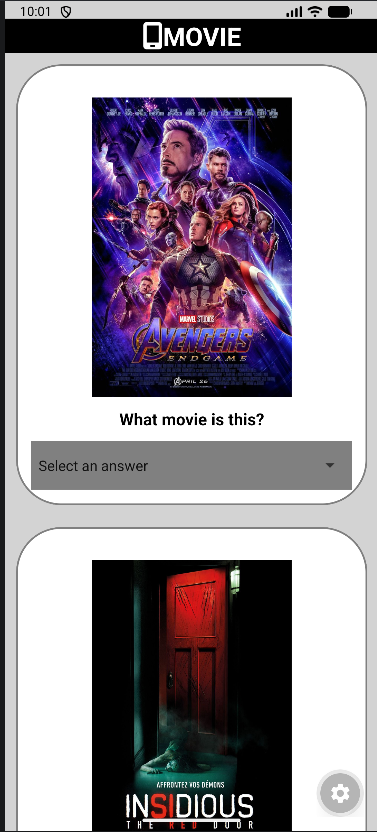

# App Name

A simple mobile quiz application developed using React Native. The app allows users to test their movie knowledge by identifying movies based on their posters.

Users can select their answers from multiple-choice options and submit them to find out how many questions they answered correctly.

# ScreenShots of App BEFORE applying Stylesheet changes

Screenshots: 

# ScreenShots of App AFTER applying Stylesheet changes

Screenshots: 

# Link to Demo Video with audible narration explaining styling changes with code reference

Demo Video Link: https://drive.google.com/file/d/1F8YTnlcXC7KizTh08tQeOAelDVJN3tzX/view?usp=sharing

